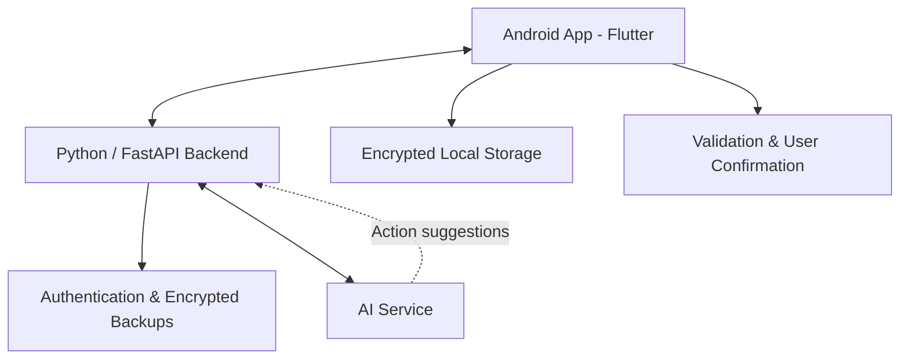

# VitaMia – AI-assisted Android Application

**An experimental Android application designed to make everyday technology more accessible, particularly for older adults.**

VitaMia is a personal software project combining mobile development, voice interaction, artificial intelligence and backend services.

The project explores how conversational interfaces can simplify common tasks while keeping critical operations under explicit user control.

## Key Features

- Manual management of medication schedules and reminders
- Offline access to essential functions
- Local data persistence and encryption
- AI-assisted conversational interaction
- Explicit confirmation before executing important actions
- Encrypted backup and identity recovery mechanisms

## Technology Stack

- **Mobile:** Flutter / Dart / Android
- **Backend:** Python / FastAPI
- **AI:** Server-side language model integration
- **Storage:** Local encrypted storage and backend database
- **Testing:** Flutter tests, Python tests and Android emulator validation
- **Infrastructure:** Containerized backend and HTTPS services

## Architecture

The application separates three main responsibilities:

1. **Android client:** User interface, local information and offline functionality.
2. **Backend:** Identity management, authentication, backups and access to AI services.
3. **AI assistant:** Natural-language interpretation and structured action suggestions.

AI-generated suggestions must pass software validation and require appropriate user confirmation before changing application data.

## Engineering Challenges

The project focuses on several technical challenges:

- Keeping essential functions operational without an Internet connection
- Protecting user data and managing authentication
- Separating AI-generated suggestions from deterministic application logic
- Handling Android notification and background execution limitations
- Testing reliability, recovery and error conditions

## Current Status

**Experimental alpha – validation in progress.**

Automated tests and Android emulator checks have been completed. Further validation on physical Android devices is required before real-world deployment.

Future extensions may include caregiver integration and wearable devices.

## Development Approach

The project uses AI-assisted software development, supported by requirements analysis, technical troubleshooting, testing and iterative validation.

## About This Repository

This is a public portfolio overview of VitaMia.

The main application source code, infrastructure configuration and development repository remain private.
